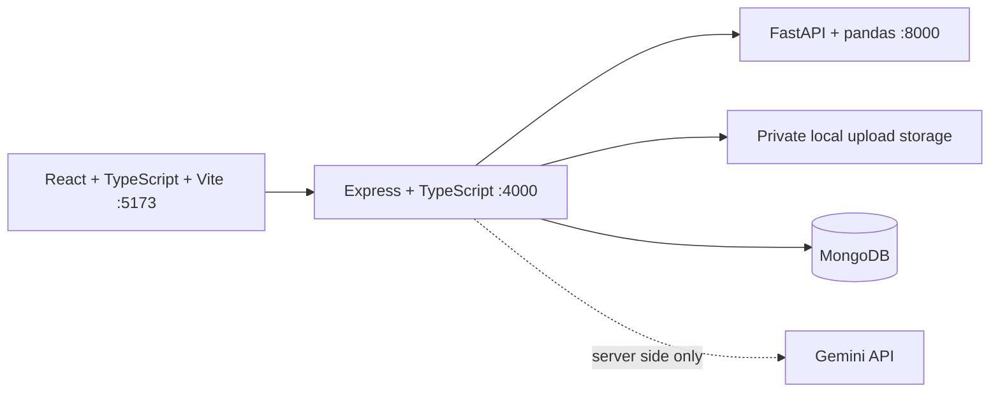

# InsightFlow

InsightFlow is an analytics workspace foundation for importing CSV/XLSX files, reviewing data quality, and later cleaning data, exploring deterministic charts, and asking questions grounded in calculated results. The current implementation includes secure auth, CSV/XLSX upload and preview, worksheet selection, private import, and deterministic data quality profiling.

## Architecture



## Prerequisites

- Node.js 24 and npm 11 (the versions available during initial setup)
- Python 3.12 and pip
- MongoDB for the authentication and persistence phases
- A Gemini API key only for the AI Q&A phase; demo and non-AI features are intended to work without it

Git was not available on PATH during initial inspection. Install Git if you want source control and phase checkpoints.

## Setup (Windows PowerShell)

1. Copy `.env.example` to `.env` and set values for your local environment. Keep `.env` private; it is ignored by Git.
2. Install JavaScript dependencies: `npm.cmd install`
3. Create a Python environment and install analysis dependencies:

   ```powershell
   python -m venv .venv
   .\.venv\Scripts\python.exe -m pip install -r analysis-service\requirements.txt
   ```

   Root scripts automatically use `.venv\Scripts\python.exe` when it exists.
4. Start all services with `npm.cmd run dev`.

## Setup (macOS/Linux)

1. Copy `.env.example` to `.env` and set local values.
2. Install JavaScript dependencies with `npm install`.
3. Create a Python virtual environment and install dependencies:

   ```sh
   python3 -m venv .venv
   .venv/bin/python -m pip install -r analysis-service/requirements.txt
   ```
4. Start all services with `npm run dev`.

## Ports and health checks

- Frontend: <http://127.0.0.1:5173>
- Backend health: <http://127.0.0.1:4000/health>
- Analysis service health: <http://127.0.0.1:8000/health>

The frontend and development services bind to loopback. The backend requires a reachable MongoDB instance before it starts. Imported originals are stored under the configured private `UPLOAD_DIR`, outside any static web path. Gemini remains unused until the AI phase.

## Developer commands

Run from the repository root (use `npm.cmd` in PowerShell if `npm` is blocked by execution policy):

| Command | Purpose |
| --- | --- |
| `npm run dev` | Start frontend, backend, and analysis service |
| `npm run build` | Build frontend and compile backend |
| `npm run lint` | Lint frontend and backend |
| `npm run typecheck` | Type-check frontend and backend |
| `npm run test` | Run frontend, backend, and analysis-service tests |

Each JavaScript workspace also has its own `dev`, `build`, `lint`, `typecheck`, and `test` scripts. Root Python commands automatically use the repository `.venv` when present.

## Environment variables

See `.env.example` for backend settings and `analysis-service/.env.example` for analysis-service settings. Set `MONGODB_URI` to a reachable MongoDB instance and replace `SESSION_SECRET` with a unique random value of at least 32 characters. The Gemini setting is not used until the AI phase. Do not put real keys in source files or commit local environment files.

## Authentication foundation

Signup and login use normalized email addresses, bcrypt password hashes, rate limits, and generic login errors. Sessions use random opaque tokens stored only as SHA-256 hashes in MongoDB; the browser receives the raw token in an HTTP-only, SameSite=Strict cookie. Sessions expire after seven days and MongoDB removes expired records. Authenticated state-changing requests require the HMAC-backed `X-CSRF-Token` returned at login/signup (or from `/auth/csrf`) and an exact allowed Origin. Production cookies are Secure. The session is fixed-length and users sign in again after expiry; password reset and email verification are not implemented yet.

Endpoints: `POST /auth/signup`, `POST /auth/login`, `POST /auth/logout`, `GET /auth/me`, and `GET /auth/csrf`. Authenticated resource routes should use the shared `requireAuth` and `requireOwner` middleware and scope database queries by the authenticated user ID.

For local use, run MongoDB on `127.0.0.1:27017` or set `MONGODB_URI` to the connection string for your own MongoDB Atlas cluster. Keep any Atlas username/password in the ignored `.env` file. The API refuses to start when MongoDB is unavailable so it does not appear healthy while authentication data cannot persist. Automated auth route tests use an in-memory store and do not require a running MongoDB instance; they do not replace a live MongoDB integration check.

## File import limits and flow

The upload API accepts `.csv` and `.xlsx` only, with a 25 MB default maximum. Parsing is also bounded to 100,000 data rows, 250 columns, and 1.5 million cells. XLSX archives are checked for entry count, expanded size (200 MB), and compression ratio before they are read. CSV delimiter and UTF-8/Windows-1252 encoding are inferred with warnings; duplicate or blank headers are renamed and reported. Empty and malformed files receive actionable errors. Blank rows ignored by the parser are reported. Excel formulas are read as cell content and never executed.

The user flow is `POST /datasets/preview` → inspect the sample and choose a worksheet with `POST /datasets/preview-sheet` → confirm with `POST /datasets/import` → request an owner-scoped report at `GET /datasets/:datasetId/profile`. Reports include row/column counts, duplicate rows, inferred types, blanks/nulls, distinct values, numeric statistics, date coverage, frequent categories, severity explanations, and heuristic column suggestions. Profiling reads the active source again and does not rewrite it. Cleaning supports preview/apply, history, undo, and reset through `/datasets/:datasetId/clean/{preview,apply,undo,reset}`. Applied changes are stored as derived CSV versions; the original upload remains immutable. History stores operation names, non-value parameters, timestamps, and row/column impacts; raw filter/fill values are omitted. Preview tickets expire after 30 minutes and are bound to the signed-in user. Temporary uploads are removed at expiry, periodically, and at backend startup. Final files use random server-generated names and dataset metadata records the owning user. The local filesystem is suitable for development only; deployment must provide durable private storage and cleanup appropriate to its hosting platform.

Deterministic analytics is available through owner-scoped `POST /datasets/:datasetId/analyze`. The strict plan operations are `summary`, `group_by`, `sort_top`, `trend`, `compare`, `missing`, `duplicates`, `correlation`, and paginated `rows`. Plans accept validated column names, typed filters, aggregation names, daily/monthly/quarterly/yearly trend granularity, and bounded limits (100 rows per result page/top-N; at most 20 filters and 20 correlation columns). The Python service performs every calculation; it never evaluates expressions or code. Correlation responses warn that association does not establish causation. Empty filter results return zero rows, and non-matching values from `contains` filters are treated as literal text.

## Dashboard

The signed-in dashboard uses `GET /datasets` to list the current owner's datasets and the same owner-scoped analytics endpoint for KPI cards, category charts, filtered rows, and server-side sorting. Search filters are sent with the KPI, chart, and table plans. The table is paginated at 20 rows and exports all currently filtered rows as CSV; chart aggregates can be exported separately. Dataset metadata includes creation date, file size, row/column counts, and status. Owners can rename or delete a dataset; deletion removes its metadata and attempts to clean the generated original and derived files. Saved analyses (chart settings and filters) and recent question text/calculation summaries are stored with the dataset on the server, can be opened or deleted, and are scoped to its owner. Question history is capped at 20 entries and does not store row data or answer results. CSV export is owner-scoped and bounded to 10 MB / 1.5 million cells; cells that could be interpreted as spreadsheet formulas are escaped. Chart choices include category bars and lines, date-based trends with daily, monthly, quarterly, or yearly grouping, and numeric scatter plots. Scatter previews display up to 100 filtered rows while CSV export includes all filtered X/Y pairs. Chart settings can be saved and reopened; scatter saves require two distinct numeric columns. Keyboard users can focus scrollable tables and charts; charts also provide expandable data tables for screen readers. The UI uses visible high-contrast focus outlines, labels, and reduced-motion preferences. The frontend suite covers a returning-user workflow from opening a saved dataset through filtering, saving a chart, clearing question history, renaming, and CSV export.

## Gemini Q&A

`POST /datasets/:datasetId/ask` converts a 3–500 character question into a strict analytics plan using Gemini's JSON structured output, validates supported operations and every referenced column, then runs the plan through the deterministic Python analytics service. The response includes a calculation-based answer, source facts, columns, active filters, plan summary, warnings, and the selected dataset. Gemini receives the question plus column names/types only; the uploaded rows and calculated results are not sent to Gemini. Follow-up requests can include the previous question and validated plan description only. The endpoint is authenticated, CSRF-protected, owner-scoped, capped at 12 requests per account per hour, and has a 30-second provider timeout and bounded output tokens. Missing `GEMINI_API_KEY`, quota, network, and malformed-response cases return actionable errors while dashboard features remain available. AI interpretations should still be reviewed; supported calculations do not establish causation or forecast future data.

Set `GEMINI_API_KEY` in the backend environment (the root `.env` for local development; never in frontend variables). `GEMINI_MODEL` defaults to `gemini-2.5-flash`. The Gemini key is sent in a backend-to-provider header and is never returned to the browser. The integration uses Gemini's JSON structured response mode; see [Google's structured output guide](https://ai.google.dev/gemini-api/docs/generate-content/structured-output) and [Generate Content API reference](https://ai.google.dev/api/generate-content).

Remaining roadmap areas include deployment readiness, a full manual browser and assistive-technology audit, and live MongoDB/durable-storage integration testing. Local automated tests use in-memory stores; production MongoDB and durable-storage cleanup should be validated in the deployment environment.
